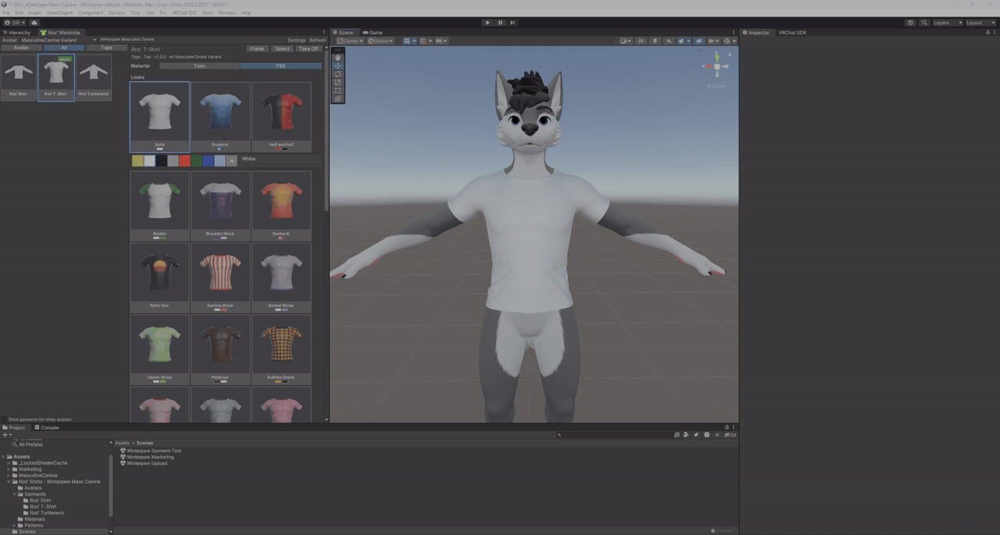
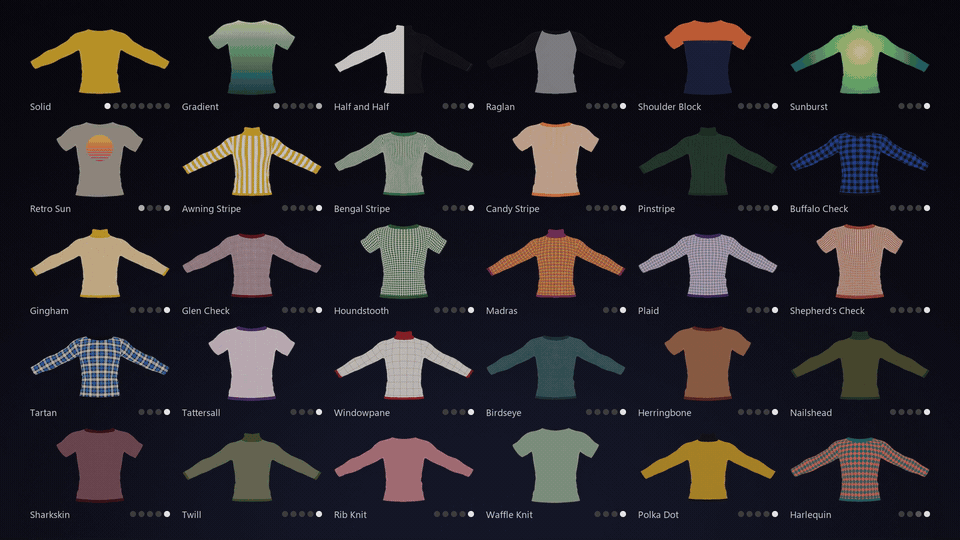
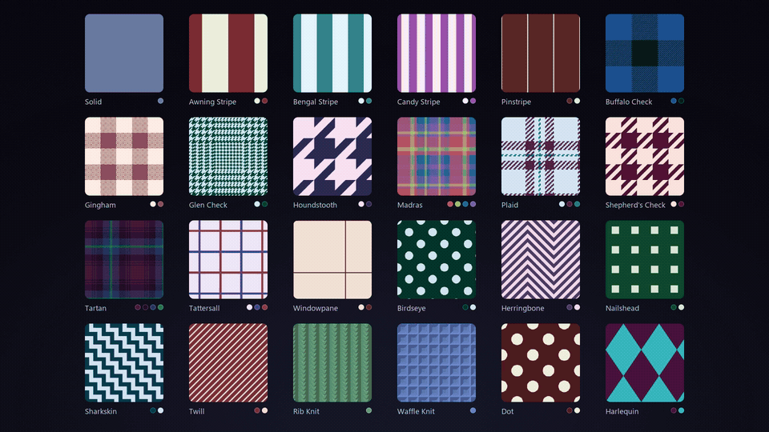

# Ros' Wardrobe

**A Sims-style wardrobe for your VRChat avatar, right inside Unity.** Put clothing on with a click, pick a look,
or make your own: a pattern and colours (or gradients) for every part of a garment, live on your avatar. When you're
done, the look is baked into an ordinary texture and material, so it uploads like any other and works with any
shader, locked Poiyomi included.

Ros' Wardrobe is free. Garments, patterns, looks and avatar bases are small files anyone can make, so clothing
from any creator can show up in the same window.

## What it does

- **Dress your avatar.** Tools → Ros' Wardrobe lists the clothing fitted to your avatar, by category. Click a
  garment to put it on, and it takes off whatever was worn in the same slot.
- **Looks and colourways.** Every garment comes with ready-made looks, each in several colourways, plus a
  **Custom** look where you pick everything yourself.
- **Patterns.** Solid and Gradient are built in. Garment packs add stripes, checks, weaves, knits, colour blocks
  and prints, at the right size on every part of the garment.
- **Gradients.** Any colour that allows it can be a gradient along the garment instead (top to bottom, sleeve to
  sleeve…).
- **Save your own.** Keep a look as a preset, and use it on any garment it fits.
- **Body and skin** (for avatar bases that describe them): shape the body with the base's sliders and recolour the
  fur, and every garment follows the body's shape.
- **Nothing to apply, nothing in your upload.** Changes are baked as you go into
  `Assets/Wardrobe Recolors/<Avatar>/<Garment>`, outside the garment's own files. The only part of Ros' Wardrobe
  that can end up in an upload is the small double-sided shader of the PBR material.

## Installing

Ros' Wardrobe installs through the VRChat Creator Companion (VCC):

1. Open <https://itsrosfox.github.io/ross-wardrobe/> and click **Add to VCC**. Or, in VCC, go to
   *Settings → Packages → Add Repository* and paste `https://itsrosfox.github.io/ross-wardrobe/index.json`.
2. *Manage Project* on your avatar project and add **Ros' Wardrobe**.
3. Import the garments you bought **after** installing Ros' Wardrobe, so their files are read as Ros' Wardrobe
   files.

Ros' Wardrobe needs Unity 2022.3, the version VRChat uses.

## Using it

1. Open **Tools → Ros' Wardrobe** and pick your avatar at the top.
2. Click a garment on the left to put it on.
3. Click a **Look**, then one of its colourways. Or open **Custom** and choose a pattern and colours for each part.
4. That's it. Upload as usual.

The full guide, with the Avatar section (body sliders and skins), presets and where everything is saved:
[Using Ros' Wardrobe](docs/using-ros-wardrobe.md).

## For creators

Everything Ros' Wardrobe shows comes from small json files it finds anywhere in the project, linked by their ids.
That means you can:

- **make garments** for any avatar base and ship them with recolouring built in,
- **add patterns and looks** to your own garments, or to someone else's,
- **describe an avatar base** (its body sliders, toggles and fur), so the Avatar section can shape and recolour it,
- **add material types** for the shader you use (Poiyomi, lilToon, Standard…).

Start with the guides:

| Guide | What it covers |
| --- | --- |
| [Making a garment](docs/making-a-garment.md) | From a skinned mesh to a recolourable garment pack, step by step |
| [Adding an avatar base](docs/adding-an-avatar-base.md) | The `.ravt` that tells Ros' Wardrobe which avatars a garment fits, plus body sliders and fur |
| [Patterns and looks](docs/patterns-and-looks.md) | Tiling, hybrid and complete patterns, Marvelous Designer fabrics, presets and colourways |
| [Material types](docs/material-types.md) | Making looks bake into your shader's material |
| [File reference](docs/file-reference.md) | Every field of every config file |

## Clothing that supports Ros' Wardrobe

- **Ros' Shirts** for Winterpaw's Masculine Canine: a T-shirt, a shirt and a turtleneck, with 30 looks each and
  28 patterns. [On Jinxxy](https://jinxxy.com/ItsRosfox/shirts-winterpaw-masc-canine)

Made something for Ros' Wardrobe? Open an issue with a link and it can go on this list.

## Support Ros' Wardrobe

Ros' Wardrobe is free for everyone, players and creators alike. If it saved you time, or you'd like to see it grow
(more avatar bases, more garments, new features), please consider supporting it on Patreon:

**[patreon.com/cw/Rosfox](https://www.patreon.com/cw/Rosfox)**

Thank you!

## Feedback and contributing

Found a bug or have an idea? [Open an issue](https://github.com/itsrosfox/ross-wardrobe/issues). Fixes and
improvements are welcome as pull requests to this repository.

## Licence

Ros' Wardrobe is **free to use**, for any project, including paid avatars and clothing. You may **include it,
unmodified, with what you make** for it. What you make for it is yours. To keep one Ros' Wardrobe that everyone's
clothing works with, **modified versions and forks may not be distributed**: please send changes here instead.
See [LICENSE.md](LICENSE.md) for the full terms.
